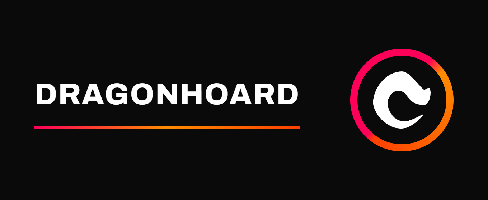

<p align="center">
  
</p>

# Dragonhoard

A Discord economy game, played a few slash commands at a time. Built with `discord.py` and SQLite.

Dragonhoard is a personal project in active development. The code is public to read and follow along with; it isn't (yet) pitched as a product or a hosted service.

## The game

Every server the bot joins gets its **own currency and its own economy** — nothing carries over between servers.

The core loop:

1. **Mine** — `/mine place` puts a drill in the ground (your first Iron Drill is free). It mines on its own, online or not, with no daily cap.
2. **Collect** — `/collect` empties your drills into your inventory.
3. **Sell** — `/market sell` sells to the best bidder and `/market buy` buys from the cheapest seller, player or server. Ores and metals trade only with the server; gemstones, components, containers and drills trade between players with `/market list` and `/market order`.
4. **Reinvest** — smelt ore in the `/furnace` (or a hundred at a time in the `/blast` furnace), craft gear and drill upgrades in the `/factory`, press gems in the `/press`, and break things back down in the `/scrapper`. Every fee counts toward **mining slots**: another drill for everyone in the server.
5. **Check the board** — `/jobboard` shows the task your server pays a bonus for today. It pays every time you finish it.
6. **Bet on it** — `/bet open` stakes your currency on something happening; others back you or bet against you, and the winners split the pot. The bot takes no cut.
7. **Elect a government** — every Thursday the server votes (`/vote`) for a **Mayor** and a **Treasurer**. The Treasurer sets fees and taxes; the Mayor spends them on projects and can sell bonds (`/bonds buy`). Admins don't set fees.

Look things up in-game with `/recipe` (the recipe book) or `/help` (also `/manual` or `/man`).

And `/honk` plays a honk. No further questions.

### Commands at a glance

| Command group | What it does |
| ------------- | ------------ |
| `/mine place\|status\|remove\|attach\|detach`, `/collect` | Drill placement, storage containers and harvesting |
| `/balance`, `/inventory` | What you have |
| `/market sell\|buy\|status` | Trade with the server, and with other players |
| `/market list\|order\|cancel` | Put your own goods or bids on the server's books |
| `/market entries` | Your own open listings and orders |
| `/economy status` | This server's economy at a glance: wealth, mining slot progress, GDP and queues |
| `/economy gdp` | What this server produced: value added by stage, over 24h and 7d |
| `/furnace smelt\|status\|queue` | Smelt ore (consumes coal) |
| `/blast smelt\|status\|queue` | The blast furnace: the same recipes, in batches of 100 |
| `/factory craft\|upgrade\|status\|queue` | Craft gear and drill upgrades |
| `/press craft\|status\|queue` | Compress materials into gems |
| `/scrapper scrap\|drill\|status\|queue` | Recycle components and drills back into materials |
| `/jobboard` | Today's paid task for this server |
| `/bet open\|place\|status\|close\|resolve\|cancel` | Bet this server's currency on what happens next |
| `/vote mayor\|treasurer`, `/government status` | This server's weekly election, and who holds office |
| `/treasurer fee\|rate\|bondrate` | The Treasurer's settings |
| `/mayor fund\|enhance\|slots\|bonanza\|bonds` | The Mayor's projects |
| `/bonds buy\|holdings` | Lend the server currency, repaid out of its revenue |
| `/recipe factory\|furnace\|press\|scrapper` | The recipe book |
| `/help`, `/manual`, `/man` | The in-Discord manual |
| `/changelog [version]` | What changed in each release |
| `/setup currency\|channel\|max_queue\|messages` | Server-manager configuration |
| `/honk` | Honk |

Replies are private by default; a server manager can make them public with `/setup messages public`, or keep the bot to one channel with `/setup channel`.

## Project structure

```
dragonhoard/
├── bot.py                    # Entry point - run this to start the bot
├── config.py                 # Loads settings from .env
├── requirements.txt          # Python dependencies
├── .env.example              # Template for secrets (copy to .env)
├── dragonhoard.service       # systemd unit file for running as a background service
├── database/
│   ├── db.py                 # Async-safe SQLite wrapper
│   └── schema.sql            # Table definitions
├── data/
│   ├── materials.py          # Game balance data (drop rates, recipes, drill stats)
│   └── manual.py             # Text of the in-Discord manual served by /help
├── utils/                    # Helpers shared by all cogs
│   ├── db_helpers.py         # Common inventory/balance/stock queries
│   ├── drills.py             # Drill instance helpers
│   ├── embeds.py             # Embed colors, footer, field helpers
│   ├── formatting.py         # Currency/number display, job durations and ETAs
│   ├── guild_helpers.py      # Per-guild config lookups
│   ├── channel_guard.py      # The designated-bot-channel check (one place, on the command tree)
│   ├── job_board.py          # Posting and claiming the daily job
│   ├── receipts.py           # Job receipt embeds
│   └── responses.py          # Public-vs-ephemeral response handling
├── assets/                   # Files the bot sends, plus branding (logo, banner)
├── docs/                     # Design docs (market, mining, stylization, deployment, ...)
├── web/                      # Dragonhoard Ops: a private read-only stats dashboard (see docs/ops-dashboard.md)
├── tests/                    # unittest suite
└── cogs/                     # One file per command group ("cog" = discord.py's plugin unit)
    ├── setup.py              # /setup currency, /setup channel, /setup max_queue, /setup messages
    ├── economy.py            # /balance, /inventory, /market sell|buy|status|list|order|cancel, /economy status|gdp
    ├── mining.py             # /mine place|status|remove|attach|detach, /collect
    ├── furnace.py            # /furnace smelt|status|queue
    ├── blastfurnace.py       # /blast smelt|status|queue (bulk smelting, 100x)
    ├── factory.py            # /factory craft|upgrade|status|queue
    ├── press.py              # /press craft|status|queue (the hydraulic press)
    ├── scrapper.py           # /scrapper scrap|drill|status|queue (recycling)
    ├── jobboard.py           # /jobboard (the daily paid task)
    ├── betting.py            # /bet open|place|status|close|resolve|cancel (prediction bets)
    ├── government.py         # /vote, /government, /treasurer, /mayor, /bonds (the elected government)
    ├── recipe.py             # /recipe factory|furnace|press|scrapper (the recipe book; furnace covers both smelters)
    ├── manual.py             # /help, /manual, /man (the same manual under three names)
    ├── changelog.py          # /changelog (release notes, from 1.1 onward)
    └── fun.py                # /honk (and anything else that's purely for fun)
```

## Running it

Short version, for anyone comfortable with Python:

```bash
git clone <this repo> dragonhoard && cd dragonhoard
python3 -m venv venv && source venv/bin/activate
pip install -r requirements.txt
cp .env.example .env   # then fill in your bot token
python bot.py
```

You'll need a bot application from the [Discord Developer Portal](https://discord.com/developers/applications) with the **Server Members Intent** enabled (the bot counts each server's human members to size its market's target stock and weight its job board; it does not keep the member list).

The long version — a start-to-finish beginner walkthrough covering Proxmox LXC setup, a dedicated service user, and running permanently under systemd — lives in [docs/deployment.md](docs/deployment.md).

## Tests

```bash
python -m unittest discover tests
```

## License

Dragonhoard is licensed under the [GNU Affero General Public License v3.0](LICENSE) (AGPL-3.0). In short: you're free to run, study, modify, and share this code, but if you run a modified version as a service for others, you must make your modified source available too.

Copyright © 2026 Isaac Day
